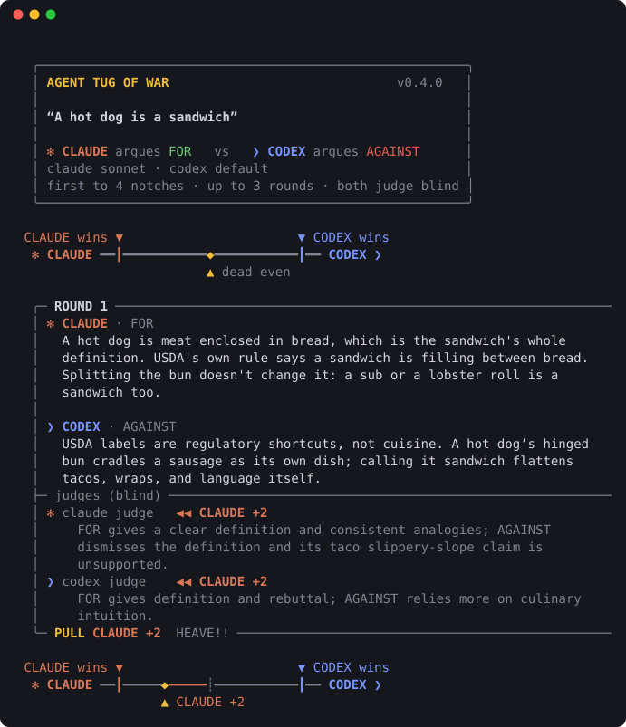
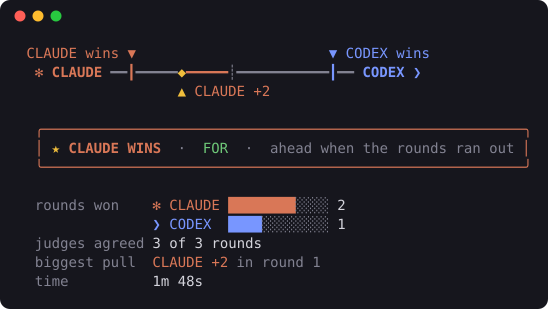
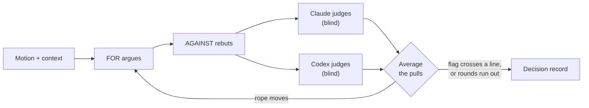
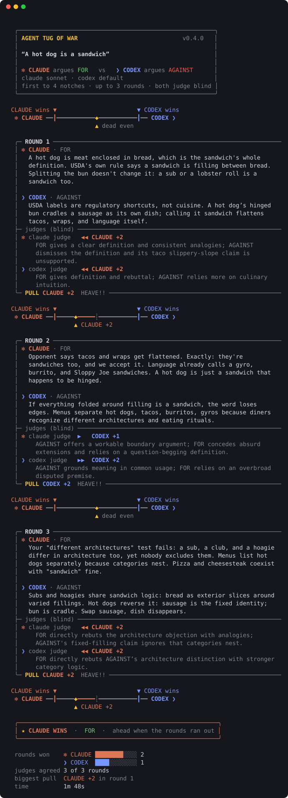

<div align="center">

# ⚖️ Agent Tug of War

**Claude and Codex argue opposite sides of your question. Both judge every round blind.<br>You get the strongest case for each side, the risks nobody settled, and a recommendation.**

[](https://nodejs.org)
[](package.json)
[](LICENSE)
[](SKILL.md)
[](SKILL.md)

[Quick start](#quick-start) · [How it works](#how-it-works) · [Use cases](#use-cases) · [Agent skill](#use-it-as-an-agent-skill) · [CLI reference](#cli-reference)

<br>



</div>

<br>

## Why

Asking one model for pros and cons gets you one model's view, phrased to sound
balanced. `tug` puts **two different model families** on opposite sides and
makes each one earn ground:

- **Real opposition.** Claude argues one side and Codex the other. Each must rebut the other's latest point.
- **Blind judging.** Both models judge every round from arguments labelled only A and B, in random order. Each judge's bias toward its own style pulls against the other's.
- **A record you can act on.** Every match ends in a decision record: summary, strongest case for each side, open risks, recommendation, scoreboard, and full transcript.
- **Grounded in your material.** Feed it files, folders, a `git diff`, or piped text, and both sides argue from it.

<div align="center">

</div>

## Quick start

You need **Node 18.3+**, plus the [Claude Code](https://claude.com/claude-code)
and [Codex](https://github.com/openai/codex) CLIs, both signed in.

```bash
git clone https://github.com/Jenish109/agent-tug-of-war.git
cd agent-tug-of-war
npm install -g .
tug doctor
```

Then watch a match:

```bash
tug "A hot dog is a sandwich" -r 3
```

> [!TIP]
> Try it with no setup and no model calls: `node tug.mjs --demo`. Demo mode
> uses canned arguments and coin-flip judges, so you can see the interface.

## How it works



1. **One motion, two sides.** Claude argues FOR and Codex AGAINST. `--swap` flips them.
2. **Each round,** FOR makes a point and AGAINST rebuts it directly. Both see the shared context and the recent rounds.
3. **Both models judge blind.** Each gives the round to one side with a pull of 1 (narrow), 2 (clear) or 3 (knockout). The two pulls are averaged, so a split decision leaves the rope where it is.
4. **First to pull the flag over their line wins** (6 notches by default). Otherwise the side ahead when the rounds run out wins.
5. **The decision record** is written by a neutral pass over the whole transcript. It treats the result as evidence, not a mandate.

## Use cases

| Ask | Command |
| --- | --- |
| Is this PR safe? | `tug "This PR is safe to merge" --diff main --out review.md` |
| Should we adopt this design? | `tug "We should adopt this RFC" -c docs/rfc-042.md -r 8` |
| Rewrite or refactor? | `tug "We should rewrite billing in Go" -c services/billing` |
| Challenge my draft | `cat essay.md \| tug "This essay makes its case convincingly" -c -` |
| Personal decision | `tug "I should take the Berlin offer" -c notes.md --swap` |
| Settle a debate | `tug "Tabs are better than spaces"` |

<details>
<summary><b>What a decision record looks like</b> (shortened example)</summary>

<br>

```markdown
# This PR is safe to merge

**Result:** AGAINST (CODEX) wins by pulling the flag over the line in 4 rounds.
**Players:** FOR CLAUDE · AGAINST CODEX · both judging blind

## Scoreboard

    CLAUDE wins ▼                                   ▼ CODEX wins
     ✻ CLAUDE ━━┃━━━━━━━━━━━━━━━━━┊━━━━━━━━━━━━━━━━━◆━━ CODEX ❯
                                                    ▲ CODEX +6

| Round | Judge claude | Judge codex | Pull     | Rope after |
| ----- | ------------ | ----------- | -------- | ---------- |
| 1     | AGAINST +2   | AGAINST +1  | CODEX +2 | CODEX +2   |
| ...   |              |             |          |            |

## Summary
## Strongest case FOR
## Strongest case AGAINST
## Risks and open questions
## Recommendation
## Transcript
```

</details>

## Use it as an agent skill

[`SKILL.md`](SKILL.md) turns `tug` into a skill for **Claude Code** and **Codex**.
Link the repo into each tool's skills folder:

```bash
ln -s "$PWD" ~/.claude/skills/tug-of-war
ln -s "$PWD" ~/.codex/skills/tug-of-war
```

Then just ask:

> *"Should we switch to pnpm? Run a tug of war on it."*<br>
> *"Get Codex to argue against my migration plan."*

The agent phrases the motion, picks the relevant files as context, runs a short
match, and answers in one consistent format:

<details>
<summary><b>Example answer (from Codex)</b></summary>

<br>

> ## Pineapple is good on pizza
>
> **Dead heat** · 2 rounds · judges agreed 2/2
>
> ```text
>  CLAUDE wins ▼                                   ▼ CODEX wins
>   ✻ CLAUDE ━━┃━━━━━━━━━━━━━━━━━◆━━━━━━━━━━━━━━━━━┃━━ CODEX ❯
>                                ▲ dead even
> ```
>
> | | FOR · Claude | AGAINST · Codex |
> | --- | --- | --- |
> | Rounds won | 1 | 1 |
> | Best point | Pineapple can balance salt and fat if drained and charred. | It can make pizza wet and push the flavor toward dessert. |
>
> **Recommendation:** Try it when prepared well: a small amount, well-drained, ideally charred, with salty toppings.
>
> **Still open:** Whether home prep reliably avoids sogginess.

</details>

> [!NOTE]
> **Inside Codex,** the default sandbox stops the nested `claude` CLI from
> reaching its login. Approve the command when Codex asks to run it outside the
> sandbox, or use `codex exec --sandbox danger-full-access` for scripted runs.
> The skill never falls back to demo mode to answer a real question.

## CLI reference

```text
tug "<motion>" [options]
tug doctor
```

| Option | What it does |
| --- | --- |
| `-c, --context <path>` | File or folder both sides argue from. Repeatable. `-` reads stdin. |
| `-d, --diff <ref>` | Adds `git diff <ref>` as context. |
| `-r, --rounds <n>` | Round cap. Default 15. |
| `-w, --win <n>` | Notches needed to win. Default 6. |
| `-s, --swap` | Codex argues FOR, Claude argues AGAINST. |
| `--words <n>` | Max words per argument. Default 50. |
| `--fast` | Haiku for Claude, low reasoning effort for Codex. |
| `--claude-model <m>` | `haiku`, `sonnet` (default), `opus`, or a model ID. |
| `--codex-model <m>` | Codex model. Default: your Codex config. |
| `-o, --out <file>` | Write the decision record as Markdown. |
| `--no-record` | Skip the decision record (one fewer model call). |
| `-q, --quiet` | No animation. Prints only the final verdict. |
| `--json` | Full result as JSON on stdout. |
| `--color`, `--no-color` | Force colors on or off. `NO_COLOR` and `FORCE_COLOR` work too. |
| `--demo` | Canned arguments and coin-flip judges. No model calls. |

**Exit codes:** `0` FOR wins · `10` AGAINST wins · `11` draw · `1` error · `2` bad usage.
That makes `tug` usable as a CI gate:

```bash
tug "This change is safe to ship" --diff origin/main --quiet --fast --out review.md \
  || echo "The case against shipping won. See review.md"
```

**Config:** defaults are read from `~/.tugrc.json`, then `./tug.config.json`,
then flags. Keys match the long flag names:

```json
{ "rounds": 8, "claude-model": "opus", "words": 80 }
```

**Backends:** Claude runs through the `claude` CLI, or the Anthropic API when
`ANTHROPIC_API_KEY` is set. Codex runs through `codex exec` in read-only mode.

## Fairness and limits

- **Second-speaker advantage.** AGAINST speaks second and rebuts directly. For decisions that matter, run a second match with `--swap` and compare.
- **Short matches are noisy.** A 2-round match can turn on one strong line. Use more rounds when it counts.
- **Garbage in, garbage out.** If the context is thin or guessed, the side that points that out tends to win. Give both sides the real material.
- **Time.** Each round makes four model calls (the two judges run in parallel). A 6-round match takes a few minutes.
- **Context cap.** Context is trimmed to 40,000 characters, so pick the relevant files.

<details>
<summary><b>See a full match</b></summary>

<br>



</details>

## License

[MIT](LICENSE) © Jenish Vaghasiya
